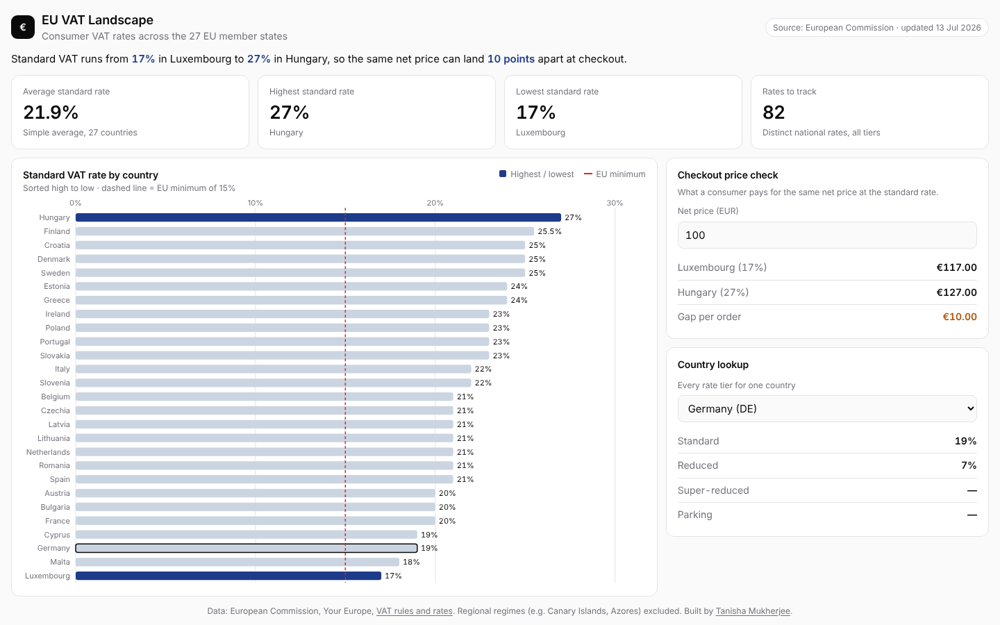

# EU VAT Landscape

A one-screen dashboard of consumer VAT rates across the 27 EU member states, built for merchants who sell cross-border.

**Live demo:** https://tanishawdh-maker.github.io/eu-vat-dashboard/



## Why

A merchant selling to EU consumers charges the VAT rate of the buyer's country. Standard rates range from **17% in Luxembourg to 27% in Hungary**, so one net price can land 10 percentage points apart at checkout. Teams that show a single EUR price either absorb that gap in margin or price per market, and getting it wrong at scale becomes a tax and compliance problem. This dashboard makes the spread visible at a glance.

## Features

- **Headline figures:** average, highest and lowest standard rate, and the number of distinct national rates a merchant has to track (82 across all tiers).
- **Ranked bar chart** of standard rates, with the EU minimum of 15% marked and a tooltip on every bar.
- **Checkout price check:** enter a net price to see what a consumer pays in the cheapest and most expensive VAT country, and the gap per order.
- **Country lookup:** every rate tier for one country (standard, reduced, super-reduced, parking). Clicking a bar selects that country.
- Fits one screen on desktop and laptop, stacks on phones, and follows the system's light or dark mode.
- No framework, no build step and no dependencies: plain HTML, CSS and JavaScript with SVG.

## Data

| | |
|---|---|
| Source | European Commission, Your Europe: [VAT rules and rates](https://europa.eu/youreurope/business/taxation/vat/vat-rules-rates/index_en.htm) |
| As of | Page last updated 13 July 2026 |
| File | [`data/vat_rates_eu_2026.csv`](data/vat_rates_eu_2026.csv) |
| Scope | 27 EU member states; regional regimes (e.g. Canary Islands, Azores) excluded |

Columns: `country`, `code` (EU code, so Greece is `EL`), `standard`, `reduced` (one or more rates separated by `/`), `super_reduced`, `parking`. Empty means the country has no rate of that type.

Rates change. Check the national tax authority before relying on a figure for filing.

### Data checks

`scripts/validate_data.py` checks the dataset before it ships: exactly the 27 EU country codes, no duplicates, numeric rates, standard rates at or above the EU minimum of 15%, reduced rates below the standard rate, super-reduced rates below 5%, and parking rates of at least 12%. A GitHub Actions workflow runs it on every push that touches the data.

```bash
python scripts/validate_data.py
```

## Run locally

The page loads the CSV with `fetch`, so serve the folder rather than opening the file directly:

```bash
git clone https://github.com/tanishawdh-maker/eu-vat-dashboard.git
cd eu-vat-dashboard
python -m http.server 8000
# open http://localhost:8000
```

## Deploy

Hosted on GitHub Pages: **Settings → Pages → Deploy from a branch → `main` / root**.

## Project structure

```
eu-vat-dashboard/
├── index.html                  # page layout
├── src/
│   ├── app.js                  # loads the CSV, computes figures, draws the chart and panels
│   └── styles.css              # one-screen grid layout, light and dark themes
├── data/
│   └── vat_rates_eu_2026.csv   # rates from the European Commission table
├── scripts/
│   └── validate_data.py        # data quality checks
├── assets/
│   └── screenshot.png
├── .github/workflows/
│   └── validate.yml            # runs the data checks in CI
└── LICENSE
```

## Next steps

- **Automate updates:** a scheduled job that pulls the latest official rates each week, diffs them against the current file, and opens a pull request when a rate changes, so the dashboard never goes stale.
- Add the UK, Norway and Switzerland for a wider European view.
- Add reduced-rate categories (food, books, digital services) per country.

## Author

**Tanisha Mukherjee** · [LinkedIn](https://linkedin.com/in/tanisha-mukherjee-760a203b6) · [GitHub](https://github.com/tanishawdh-maker)

## License

[MIT](LICENSE)
